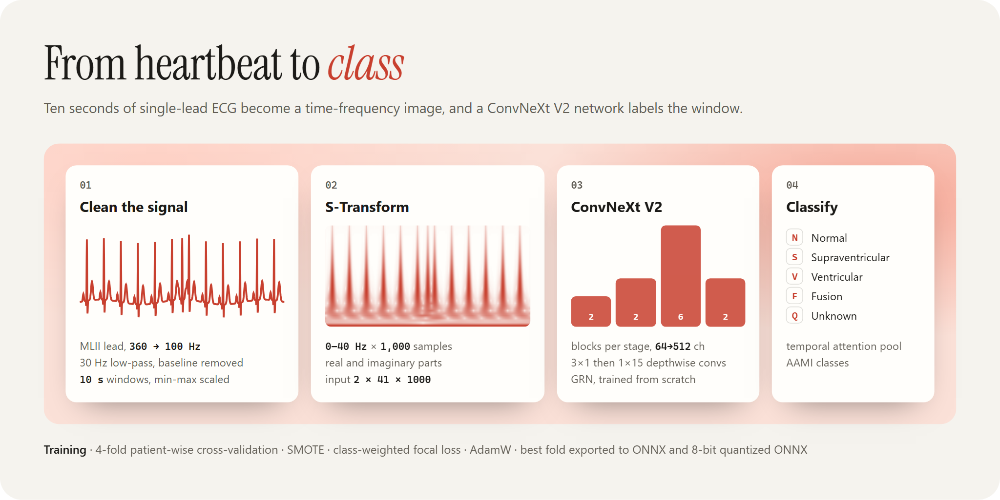

<picture>
  <source media="(prefers-color-scheme: dark)" srcset=".github/readme/pipeline-dark.png">
  
</picture>

# ECG ConvNeXt V2 classifier

A learning project that classifies arrhythmia in single-lead ECG with a ConvNeXt V2 network in PyTorch. Each 10-second window of the MIT-BIH Arrhythmia Database is turned into a time-frequency image with the Stockwell transform (S-Transform) and labelled with one of the five AAMI classes. The best model is exported to ONNX, full precision and quantized.

> [!WARNING]
> This is not a medical device and must not be used for diagnosis. Its accuracy and macro F1 score are too low for any professional use.

The figure's ECG trace is synthetic, and its S-Transform panel is the repository's transform applied to that trace.

## How it works

1. **Signal.** Records are read from PhysioNet with `wfdb`, using the first channel (MLII in nearly every record). The signal is resampled from 360 to 100 Hz, low-pass filtered at 30 Hz and detrended, then cut into back-to-back 10-second windows of 1,000 samples, each scaled to 0 to 1.
2. **Label.** Each beat annotation is mapped to an AAMI class (N, S, V, F, Q) and a window takes the most frequent class among its beats. It classifies windows, not single beats.
3. **S-Transform.** Each window becomes a 41 × 1,000 complex matrix for 0 to 40 Hz. Its real and imaginary parts are the two input channels.
4. **Model.** A ConvNeXt V2 backbone (2, 2, 6 and 2 blocks; 64 to 512 channels) adapted to this input: a non-square stem, and each block's 7 × 7 depthwise convolution replaced by a 3 × 1 frequency convolution and a 1 × 15 time convolution. The frequency axis is pooled, a small temporal attention weights the time steps, and a linear head gives the five classes. It is trained from scratch; no pretrained weights are used.
5. **Training.** The 22 training records are split by patient into 4 folds. Each fold oversamples the minority classes with SMOTE and trains with class-weighted focal loss, AdamW, mixed precision and early stopping on validation macro F1.
6. **Export.** The best fold is saved as `models/best_model.pth` and exported to ONNX and to a dynamically quantized 8-bit ONNX model, both checked with ONNX Runtime against the PyTorch output.

Records follow the usual inter-patient split of MIT-BIH: 22 for training and cross-validation, 22 held out for evaluation. The four paced records are not used.

## Results

The repository doesn't include trained models, logs or scores. Run training and evaluation to produce your own: evaluation prints a per-class report and saves it with a confusion matrix in `results/`.

## Run it

You need Python 3 and an internet connection on the first run, when the records are downloaded from PhysioNet. A CUDA GPU is used when available; training on the CPU is slow.

```bash
git clone https://github.com/Anthonyy232/ecg-convnextv2-classifier.git
cd ecg-convnextv2-classifier
python ecg_cli.py install   # pip install -r requirements.txt
python ecg_cli.py test      # S-Transform shape and a model forward pass on random data
python ecg_cli.py hpo       # optional: Optuna search over learning rate, batch size and focal gamma
python ecg_cli.py train     # 4-fold cross-validation, checkpoints and ONNX export
python ecg_cli.py eval      # report on the 22 held-out records
```

If an HPO study exists, `train` asks whether to use its best hyperparameters. HPO runs 10 trials of a shorter cross-validation and can be stopped and resumed.

Defaults such as epochs, batch size, learning rate and the patient lists are in `src/config.py`.

| Folder | Contents |
| --- | --- |
| `data/` | Preprocessed windows cached per record (`.npz`) |
| `models/` | `best_model_fold_N.pth`, `best_model.pth`, `best_ecg_model_fold_N.onnx` and `best_ecg_model_fold_N_quantized.onnx` |
| `results/` | The HPO study, evaluation report and confusion matrix |

These folders are created on first use and ignored by Git. Data derived from MIT-BIH is not redistributed here.

## Data, code and references

**MIT-BIH Arrhythmia Database** ([PhysioNet](https://physionet.org/content/mitdb/1.0.0/), [doi:10.13026/C2F305](https://doi.org/10.13026/C2F305)), licensed under the Open Data Commons Attribution License v1.0. It is downloaded at run time and not stored in this repository. Please cite:

> Moody GB, Mark RG. The impact of the MIT-BIH Arrhythmia Database. *IEEE Eng in Med and Biol* 20(3):45-50 (May-June 2001). (PMID: 11446209)

> Goldberger, A., Amaral, L., Glass, L., Hausdorff, J., Ivanov, P. C., Mark, R., ... & Stanley, H. E. (2000). PhysioBank, PhysioToolkit, and PhysioNet: Components of a new research resource for complex physiologic signals. *Circulation [Online]*. 101 (23), pp. e215–e220.

**ConvNeXt V2.** The layers in `src/model.py` are adapted from [facebookresearch/ConvNeXt-V2](https://github.com/facebookresearch/ConvNeXt-V2) (MIT; its notice is kept in that file). That project's pretrained ImageNet weights are CC-BY-NC and are not used here.

> Woo, S., Debnath, S., Hu, R., Chen, X., Liu, Z., Kweon, I. S., Xie, S. ConvNeXt V2: Co-designing and Scaling ConvNets with Masked Autoencoders. *CVPR* (2023). [arXiv:2301.00808](https://arxiv.org/abs/2301.00808)

The approach was inspired by:

> Talukder, M.A., Khalid, M., Kazi, M. et al. A hybrid cardiovascular arrhythmia disease detection using ConvNeXt-X models on electrocardiogram signals. *Sci Rep* **14**, 30366 (2024). [https://doi.org/10.1038/s41598-024-81992-w](https://doi.org/10.1038/s41598-024-81992-w)

> El-Ghaish, H., Eldele, E. ECGTransForm: Empowering adaptive ECG arrhythmia classification framework with bidirectional transformer. *Biomedical Signal Processing and Control*, Volume 89, 105714 (2024). [https://doi.org/10.1016/j.bspc.2023.105714](https://doi.org/10.1016/j.bspc.2023.105714)

## Licence

Copyright (C) 2025 Anthony La. Licensed under the [GNU General Public License v3.0](LICENSE) (`GPL-3.0-only`). Earlier versions were published without a licence. Third-party code keeps its own licence, as noted above.
